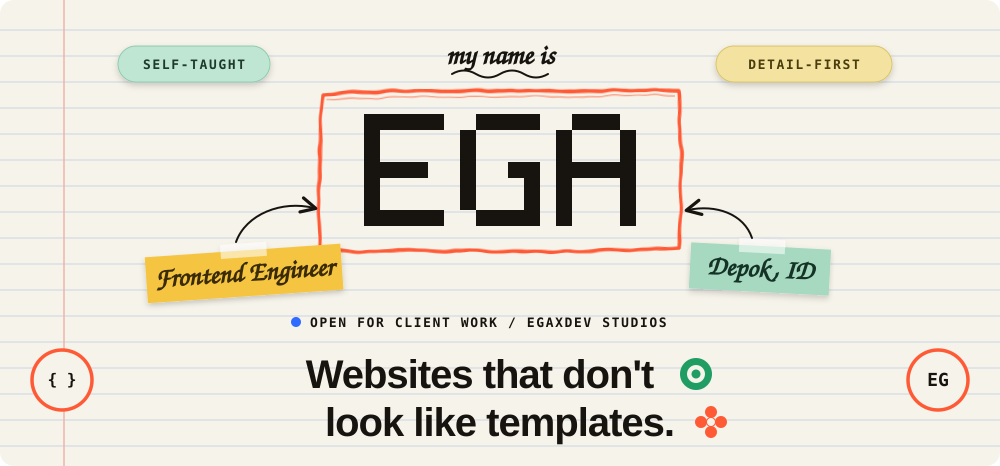
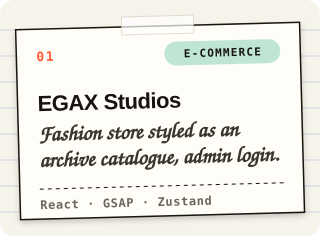
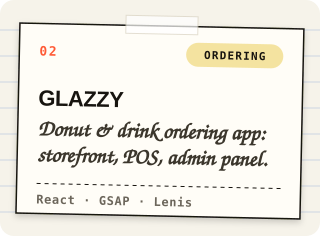
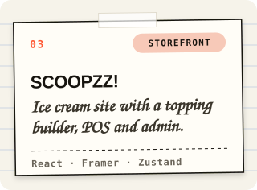
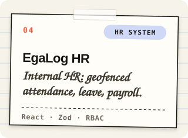
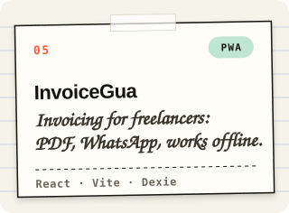
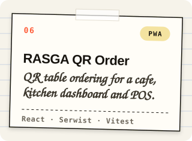

  

Self-taught frontend developer from Depok. 
I build portfolios, e-commerce and agency sites 
with React, TypeScript, Tailwind and GSAP.

 

 

 

  

 

  

 

[Instagram @evanrasyidd](https://instagram.com/evanrasyidd) &nbsp;/&nbsp; DMs open for projects

  

Handmade by EGAXDEV Studios. No widgets, no snake.

